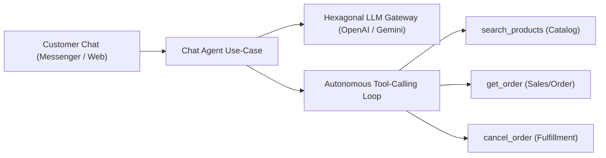

.png)

<div align="center">
  
</div>

<div align="center">
  
</div>

---

## 🚀 About Me

```typescript
const abdullahBoshir = {
  name: "Abdullah Boshir",
  role: "Full-Stack Software Engineer (SaaS, ERP & AI Systems)",
  location: "Cumilla, Chattogram, Bangladesh (Open to Remote & Relocation)",
  currentWork: "Full-Stack Developer @ Signature Bangla (signaturebangla.com)",
  flagshipSystems: [
    "Manoxen — Multi-Tenant Enterprise ERP, POS, HRM & CRM Monorepo",
    "Banijjik — No-Code Multi-Business & E-Commerce SaaS Platform",
    "Hexagonal AI Chatbot Engine — Multi-Provider LLM Gateway & Tool-Calling Agent"
  ],
  architectureFocus: [
    "3-Tier Domain-Driven Design (DDD) & Clean Architecture",
    "Multi-Tenant Data Isolation & Redis-Cached Dynamic RBAC",
    "Turborepo Monorepos & End-to-End Type-Safe Contracts (Zod)",
    "OpenAI & Google Gemini Autonomous Tool-Calling Agents"
  ],
  education: {
    mba: "MBA in Marketing (2023–2025) — Cumilla Victoria Govt. College (NU)",
    bba: "BBA in Marketing (2017–2022) — Cumilla Victoria Govt. College (NU)"
  },
  philosophy: "Engineering scalable software that solves real business operations — results over declarations."
};
```

---

## 🛠️ Technical Skills & Ecosystem

### Frontend Engineering


### Backend, Database & Architecture


### AI Engineering, Monorepo & DevOps


---

## 🏢 Production Experience & Flagship Systems

### 1. 🛍️ Signature Bangla — Commercial E-Commerce & Retail Ecosystem
> **Role:** Full-Stack Developer (`2025 – Present`, Lead Engineering Ownership from `Jul 2026`)  
> **Live Storefront:** [signaturebangla.com](https://signaturebangla.com)

- Directed technical specifications from project inception and took full hands-on ownership of an incomplete (~40%) codebase in July 2026, refactoring core modules and engineering the remaining 60% to launch into production.
- Built Google Maps reverse-geocoding location & address management, multi-step checkout workflows, and real-time **Socket.io** order status tracking using **Next.js 15, React 19, and Redux Toolkit**.
- Integrated the storefront with the company's internal multi-tenant ERP & POS platform (**Manoxen**) to synchronize live stock, order fulfillment, and retail branch operations.

---

### 2. 🏛️ Manoxen — Multi-Tenant Enterprise ERP, POS, HRM & CRM Platform
> **Architecture:** 3-Tier Domain-Driven Design (DDD) Turborepo Monorepo  
> **Live Staging / App:** [Manoxen Dashboard](https://test-app.signaturebangla.com/signaturebdtesting/dashboard) *(Enterprise Monorepo)*

- **18+ Business Verticals:** Catalog, Sales, POS, Inventory, Accounting, HRM, CRM, Logistics, and Storefront under a hierarchical **Organization → Business Unit → Outlet** tenancy model.
- **Zero-Trust Data Isolation:** Request-scoped multi-tenant isolation using Node.js `AsyncLocalStorage`, custom Mongoose query hooks, time-ordered **UUIDv7** domain IDs, and **Redis-cached Dynamic RBAC**.
- **Shared Contracts:** Unified Zod validation and DTO inference across frontend and backend workspaces, verified with Playwright E2E test suites.

---

### 3. 🚀 Banijjik — No-Code Multi-Business & E-Commerce SaaS Platform
> **Status:** Active SaaS Product *(Private Commercial Monorepo)*

- A multi-tenant **No-Code SaaS platform** designed to let merchants launch and operate complete online storefronts and multi-business operations without writing code.
- Engineered end-to-end **Cash-on-Delivery (COD)** order lifecycle management, courier delivery & fee reconciliation, lead orchestration, and boundary-enforced shared UI/validation packages.

---

### 4. 🤖 Pluggable AI Sales & Order-Management Chatbot Engine
> **Core Module:** Integrated across **Manoxen** & **Banijjik**

- **Hexagonal LLM Gateway:** Decoupled Ports & Adapters architecture supporting automatic multi-provider fallback across **OpenAI and Google Gemini**, complete with per-tenant API key resolution and token usage metering.
- **Autonomous Tool-Calling Loop:** Multi-round conversational agent capable of searching live product catalogs (`search_products`), inspecting real-time order statuses (`get_order`), and executing customer order cancellations (`cancel_order`).



---

## 🌐 Open-Source Projects

### 🏠 Hall & Dining Management System
A full-featured role-based administration platform for managing residential hall operations, student accounts, and dining meal operations.
- **Stack:** Next.js, TypeScript, Material-UI (DataGrid), Redux Toolkit, Node.js, Express.js, MongoDB, Mongoose, Zod, JWT RBAC
- **Links:** [Live Demo](https://hall-management-client.vercel.app/login) • [Client Repo](https://github.com/abdullahboshir/Hall_management_client_updated) • [Server Repo](https://github.com/abdullahboshir/Dining_management_server_updated)

### 🌍 Wayfarer (Travel Buddy) — Smart Travel Planning Platform
A full-stack travel companion application for destination discovery, trip planning, and community travel logs.
- **Stack:** React.js, Next.js, Tailwind CSS, Node.js, Express.js, PostgreSQL, Prisma ORM, JWT
- **Links:** [Live Demo](https://travel-buddy-client-eight.vercel.app/) • [Client Repo](https://github.com/abdullahboshir/Travel_buddy_client) • [Server Repo](https://github.com/abdullahboshir/Travel_buddy_server)

---

## 📊 GitHub Analytics

<div align="center">
  
  
</div>

---

## 🎓 Education & Certifications

- **Master’s (MBA) in Marketing** (2023–2025) — Cumilla Victoria Govt. College (National University)
- **Bachelor’s (BBA) in Marketing** (2017–2022) — Cumilla Victoria Govt. College (National University)
- **Next Level Web Development (Full-Stack Track)** — Programming Hero (2024)
- **Complete Web Development Course With Jhankar Mahbub** — Programming Hero (2022)
- **Communication Foundations** — LinkedIn Learning (2025)

---

## 📫 Let's Connect

<div align="center">
  <a href="https://www.linkedin.com/in/abdullahboshir/" target="_blank">
    
  </a>
  <a href="mailto:abdullahboshir@gmail.com">
    
  </a>
  <a href="https://abdullahboshir.vercel.app" target="_blank">
    
  </a>
  <a href="tel:+8801622000399">
    
  </a>
</div>
